# Procedural Texture Patterns for Encoding Changes in Color in 2.5D Treemap Visualizations

[Daniel Limberger](https://orcid.org/0000-0002-9111-4809), [Willy Scheibel](https://orcid.org/0000-0002-7885-9857), Jan van Dieken, and [Jürgen Döllner](https://orcid.org/0000-0002-8981-8583)

*Journal of Visualization* 26(2). Springer Nature, 2022, pp. 317–333.

DOI: [10.1007/s12650-022-00874-3](https://doi.org/10.1007/s12650-022-00874-3) (open access, CC BY 4.0)

> Treemaps depict tree-structured data while maintaining flexibility in mapping data to different visual variables.
> This work explores how changes in data mapped to color can be represented with rectangular 2.5D treemaps using procedural texture patterns.
> The patterns are designed to function for both static images and interactive visualizations with animated transitions.
> During rendering, the procedural texture patterns are superimposed onto the existing color mapping.
> We present a pattern catalog with seven exemplary patterns having different characteristics in representing the mapped data.
> This pattern catalog is implemented in a WebGL-based treemap rendering prototype and is evaluated using performance measurements and case studies on two software projects.
> As a result, this work extends the toolset of visual encodings for 2.5D treemaps by procedural texture patterns to represent changes in color.
> It serves as a starting point for user-centered evaluation.

<p><a href="limberger2022-changes-as-submitted.pdf">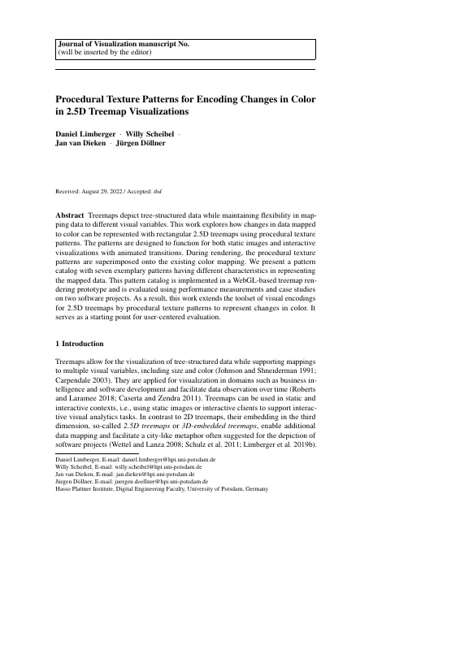</a> <a href="limberger2022-changes-as-submitted.pdf">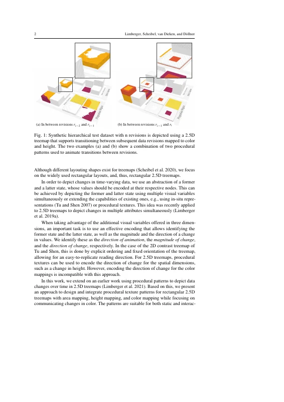</a> <a href="limberger2022-changes-as-submitted.pdf">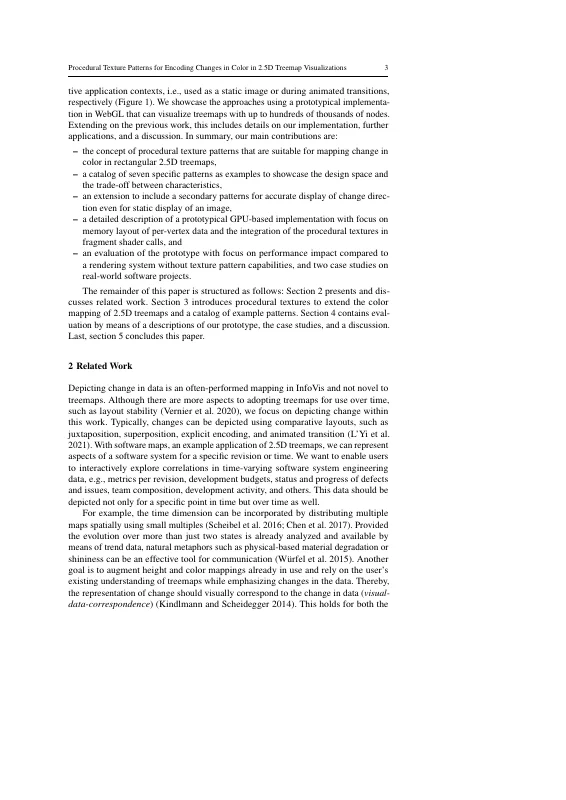</a> <a href="limberger2022-changes-as-submitted.pdf">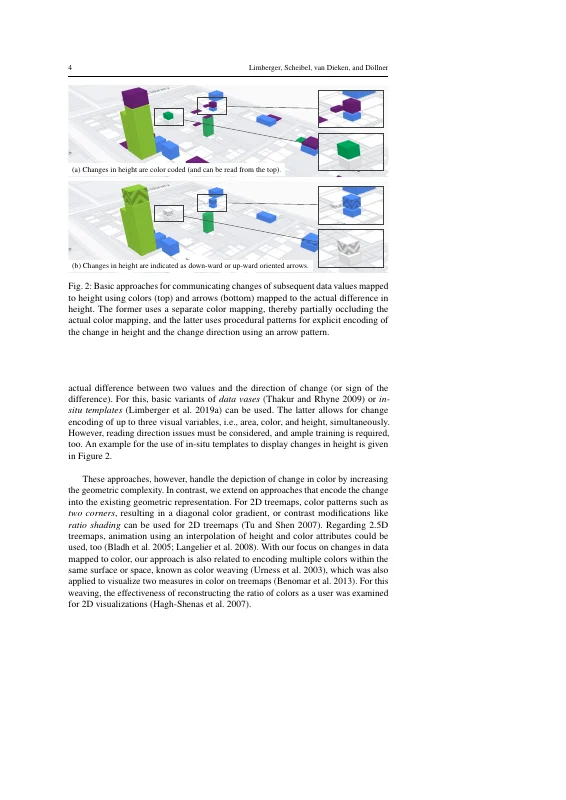</a> <a href="limberger2022-changes-as-submitted.pdf">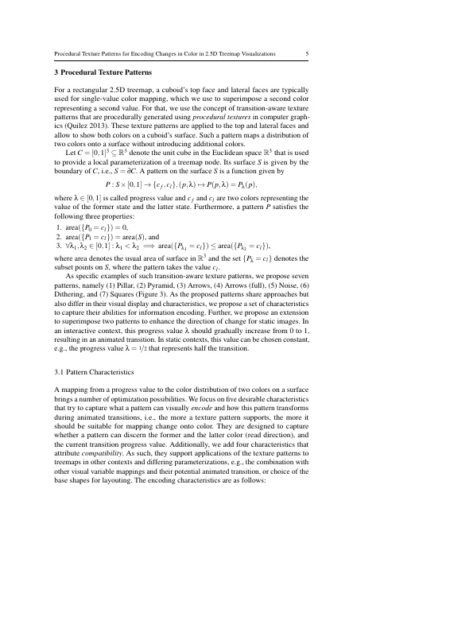</a> <a href="limberger2022-changes-as-submitted.pdf">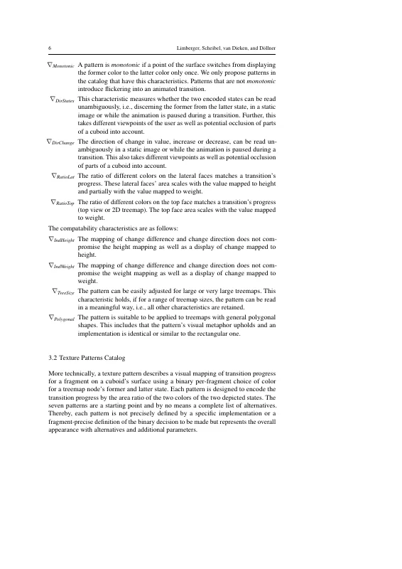</a> <a href="limberger2022-changes-as-submitted.pdf">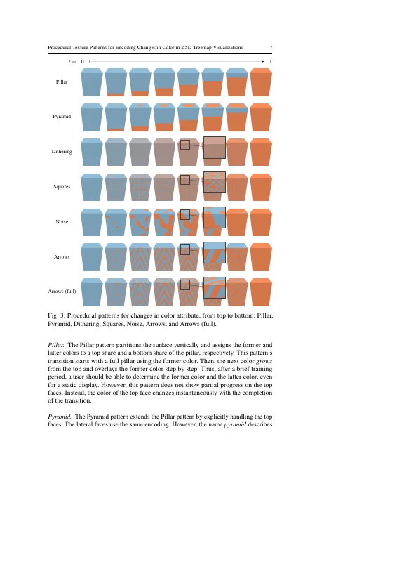</a> <a href="limberger2022-changes-as-submitted.pdf">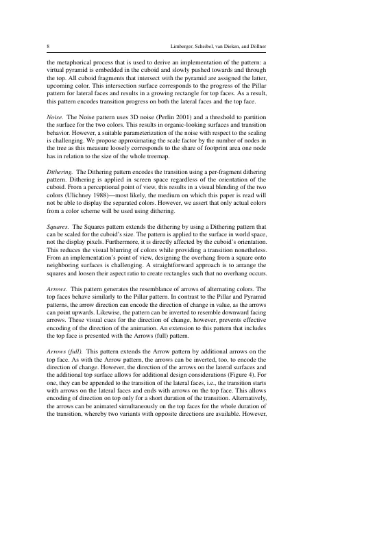</a> <a href="limberger2022-changes-as-submitted.pdf">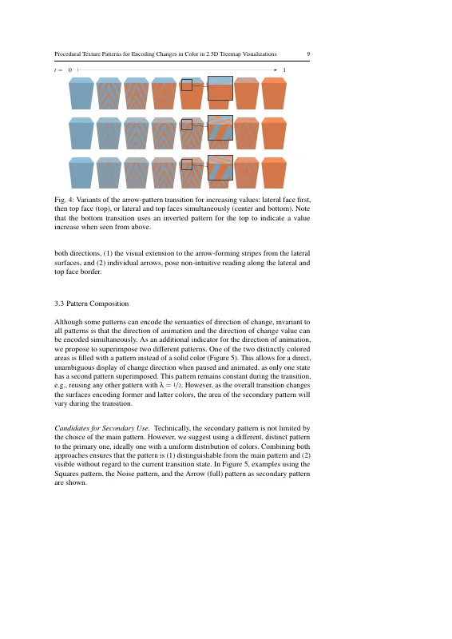</a> <a href="limberger2022-changes-as-submitted.pdf">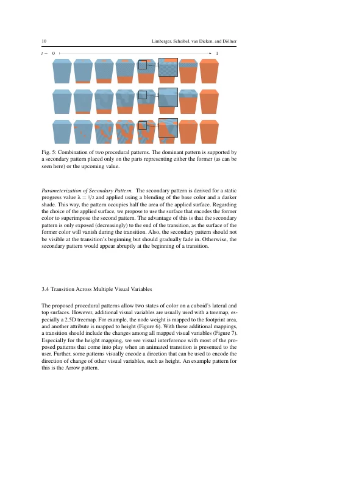</a> <a href="limberger2022-changes-as-submitted.pdf">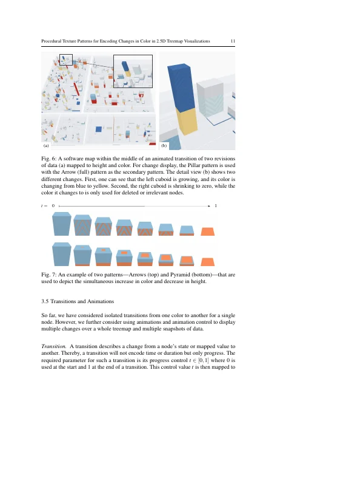</a> <a href="limberger2022-changes-as-submitted.pdf">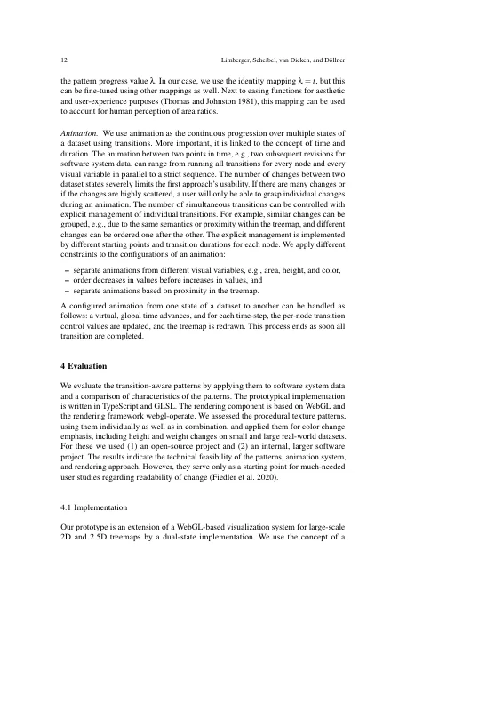</a> <a href="limberger2022-changes-as-submitted.pdf">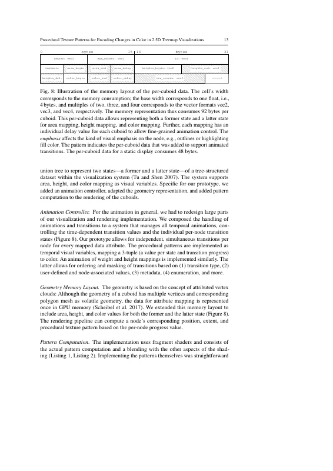</a> <a href="limberger2022-changes-as-submitted.pdf">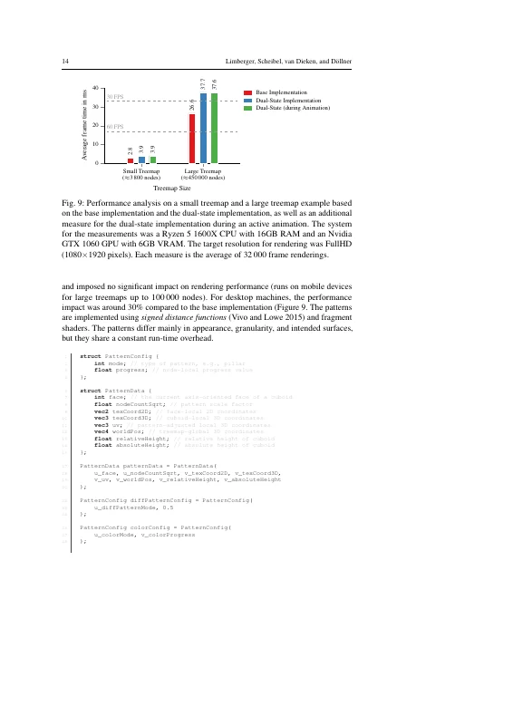</a> <a href="limberger2022-changes-as-submitted.pdf">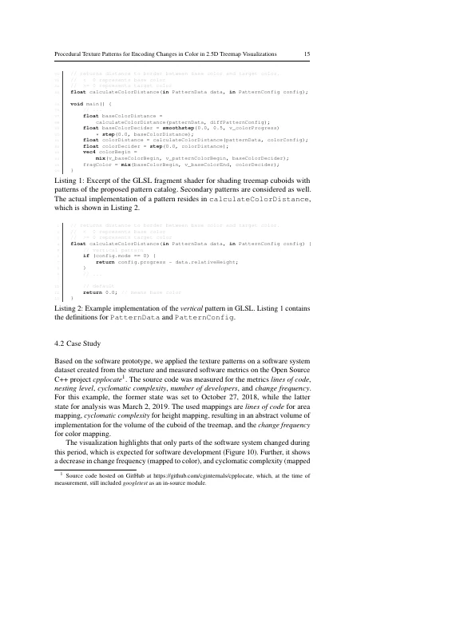</a> <a href="limberger2022-changes-as-submitted.pdf">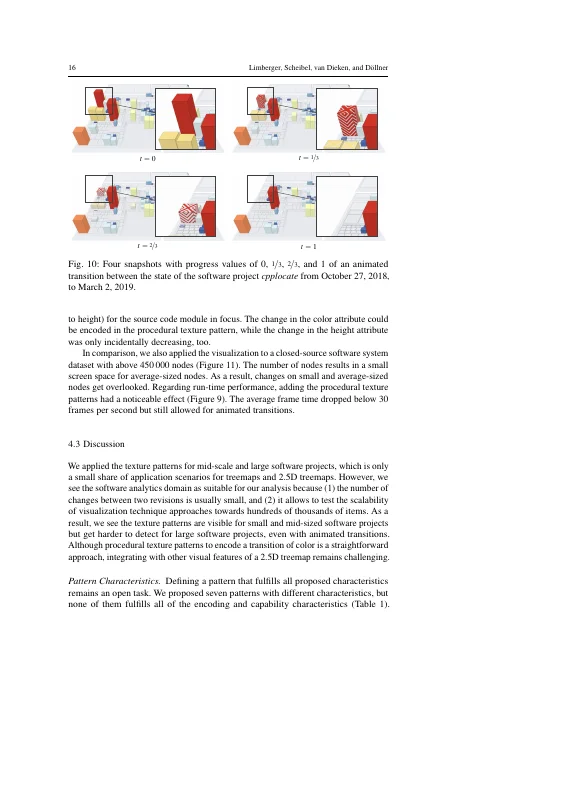</a> <a href="limberger2022-changes-as-submitted.pdf">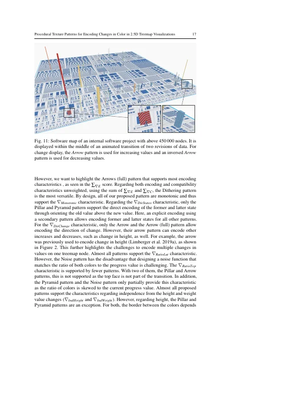</a> <a href="limberger2022-changes-as-submitted.pdf">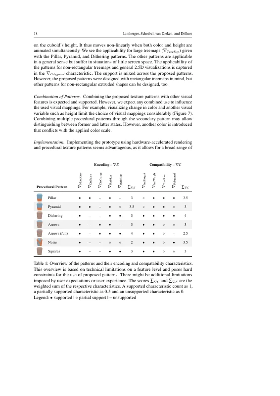</a> <a href="limberger2022-changes-as-submitted.pdf">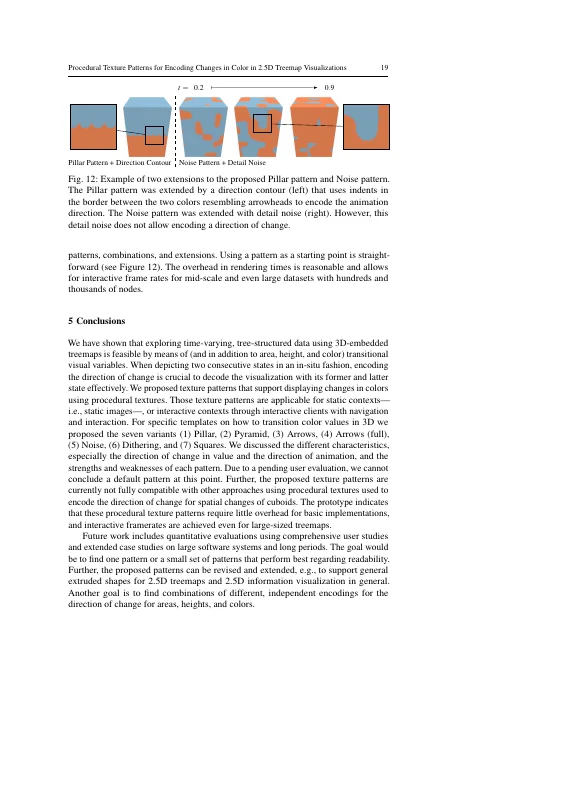</a> <a href="limberger2022-changes-as-submitted.pdf">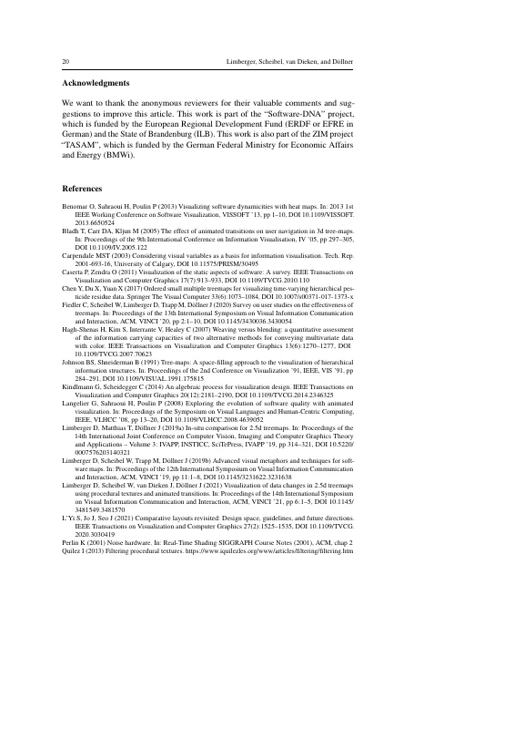</a> <a href="limberger2022-changes-as-submitted.pdf">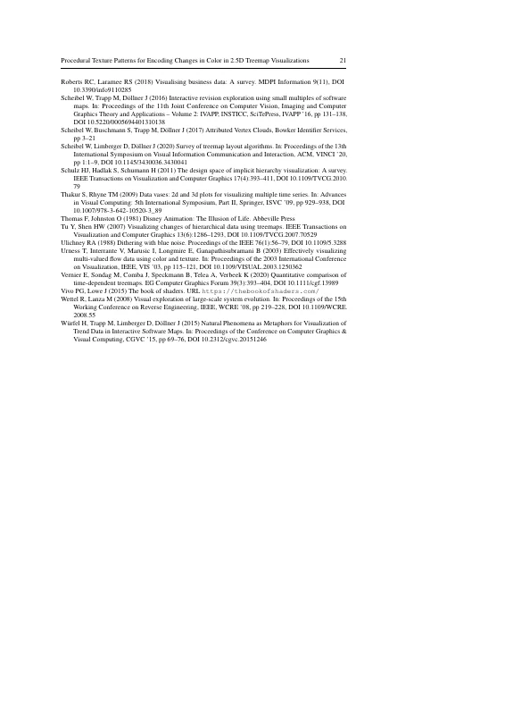</a></p>

## Contents

- [`src/`](src/) – LaTeX sources of the accepted manuscript (Springer `svjour3`, smallextended)
- [`limberger2022-changes-as-submitted.pdf`](limberger2022-changes-as-submitted.pdf) – accepted manuscript built from these sources (the original PDF of 2022-08-29 has not been preserved)
- [`build.sh`](build.sh) – reproducible build with TeX Live 2022 (podman or docker)
- [`preview/`](preview/) – page previews for this README

## Build

```bash
./build.sh        # → build/procedural-textures-treemaps.pdf
```

The manuscript was compiled in August 2022 with pdfTeX 1.40.24 (MiKTeX 22.3), hence the TeX Live 2022 container.
`build.sh` pins `\today` (used in the "Received" line) to the date of the camera-ready build, 2022-08-29.
Text and content match the version of record; the published article was typeset and copy-edited by Springer (layout, capitalization, keywords, received/accepted dates).

## Versions

- [`v1.0-camera-ready`](https://github.com/dl-archive/journal.2022-jov-changes/tree/v1.0-camera-ready) – sources of the accepted manuscript as sent to Springer (2022-08-29)

## Citation

```bibtex
@Article{limberger2022-changes,
  author    = {Limberger, Daniel and Scheibel, Willy and van Dieken, Jan and D{\"o}llner, J{\"u}rgen},
  title     = {Procedural Texture Patterns for Encoding Changes in Color in 2.5D Treemap Visualizations},
  journal   = {Journal of Visualization},
  year      = {2022},
  publisher = {Springer Nature},
  doi       = {10.1007/s12650-022-00874-3},
  volume    = {26},
  number    = {2},
  pages     = {317--333},
}
```
